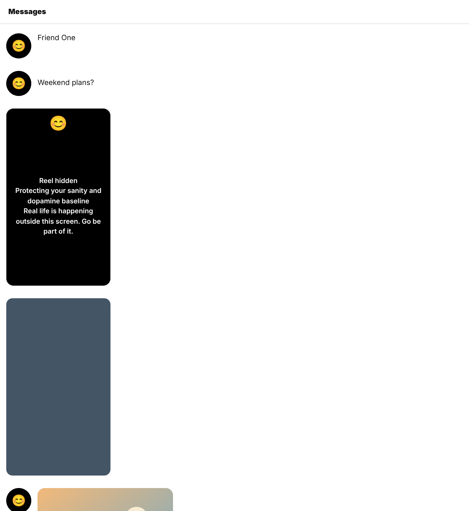
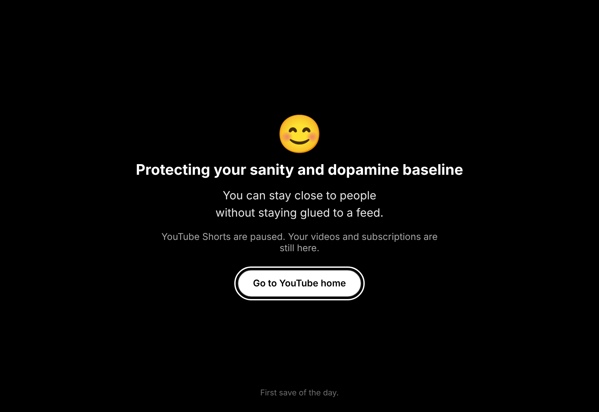
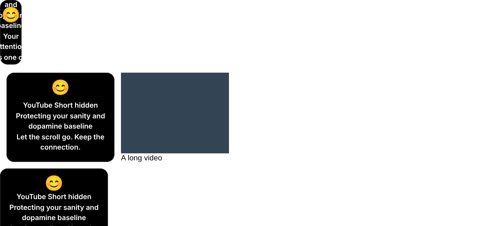

# 😊 Sanity: messaging without doomscrolling

A free, open-source Chrome extension. It keeps the people in your life one click away and hides the feeds that eat your time.

*Keep the connection. Lose the addiction.*

- Free forever
- Open source (MIT)
- No tracking or analytics
- No accounts, no servers, no network requests of its own
- No subscriptions or ads
- Messaging without doomscrolling

> Sanity protects communication, not consumption.

Sanity is an independent project. It is not affiliated with, endorsed by, or connected to Instagram, Meta, TikTok, Google, YouTube, Spotify, WhatsApp, Microsoft, or DuckDuckGo.

## Screenshots

These come from the extension running on mock pages in `tests/fixtures`. No real accounts, names or photos are used.

| Chat: Reel and profile pictures covered, friends' photos visible | YouTube Shorts page |
|---|---|
|  |  |



Every covered item shows a calm card with a short, kind line. The lines rotate, so there is always something worth reading.

## What it covers

| Where | Visible | Covered |
|---|---|---|
| **Instagram** | Direct messages, text, emoji, story replies (text), photos and videos friends send, one-time photos and videos, voice notes, login pages, notifications and follow requests | Feed, Reels, Explore, Stories, profiles, search. Reels, posts and story thumbnails shared in a chat. Profile pictures (a smiley instead). |
| **TikTok** | Messages, sign-in pages | Feed, videos, profiles, search. TikToks shared in chats and search results. |
| **YouTube** | Everything except Shorts: home, videos, search, subscriptions, playlists, comments | `/shorts` pages, Shorts cards, Shorts shelves, the Shorts entry in the sidebar |
| **YouTube Music** | Music playing, the player controls, the song list | Every thumbnail and album picture. The music video picture (the sound keeps playing). |
| **Spotify (web)** | Music playing, the player controls, the song list | Album, playlist and artist pictures, and looping video (Canvas) |
| **WhatsApp (web)** | Chats and text | Reels, YouTube Shorts, TikToks and posts that arrive as links. Profile pictures (a smiley instead). |
| **Google, Bing, DuckDuckGo** | Ordinary results | Results that link to Reels, Shorts, TikToks, posts or stories. Explicit searches, explicit results and explicit pictures show the cover. Results and pictures stay hidden until they are checked. On Images pages, a picture that can't be checked is covered too. |

Anything Sanity doesn't recognise is covered. A covered item can't be clicked, and there is no "reveal" button.

Sanity is built to leave alone audio, and the photos and videos people send you. It covers those only when they are a shared Reel, Short, TikTok or post.

## Install (step by step)

You don't need to be a developer. You only need Chrome on a computer.

1. Click the green **Code** button at the top of this page and choose **Download ZIP** (or clone with `git clone https://github.com/Kivitas/sanity.git`).
2. Unzip the file. You get a folder with `manifest.json` at its top level. That folder is the extension.
3. In Chrome, type `chrome://extensions` in the address bar and press Enter.
4. Turn on **Developer mode** (switch in the top right).
5. Click **Load unpacked**.
6. Select the folder that contains **`manifest.json`** (the top folder you unzipped or cloned). Click **Select Folder**.
7. Pin Sanity: click the puzzle icon in Chrome's toolbar, then the pin next to Sanity.
8. Open <https://www.instagram.com/direct/inbox/>.

> **Which folder?** The one with `manifest.json` directly inside it. Not a folder inside it, and not the zip file.

For a shorter guide, see [INSTALL.md](INSTALL.md).

### Packed `.crx` file (optional)

`sanity.crx` in this repo is an older packed build (0.3.0). Chrome blocks `.crx` files from installing outside the Chrome Web Store, so use **Load unpacked** to run Sanity. To pack a new one:

1. Go to `chrome://extensions`, turn on **Developer mode**, and click **Pack extension**.
2. **Extension root directory:** the folder with `manifest.json`.
3. **Private key file:** leave it empty the first time.
4. Chrome creates a `.crx` and a `.pem` file in the folder above. Keep the `.pem` private. You need it to sign later updates. It is ignored by git. Never upload it.

### Update to a new version

1. Replace the files in your Sanity folder (or `git pull`).
2. Go to `chrome://extensions` and click the reload icon on Sanity.

### Uninstall

`chrome://extensions`, then **Remove** under Sanity.

## Features

- **Start in messages:** opening instagram.com takes you straight to your inbox.
- **Toolbar badge:** blank when on, `II` when paused, `OFF` when off.
- **Shortcut:** Alt+Shift+M opens your Instagram messages (change it at `chrome://extensions/shortcuts`).
- **Turn-off PIN:** turning off needs your PIN. Set it in Settings.
- **Motivational lines:** every cover shows a short, kind line, and the lines change.
- **Settings page:** your own message for the black screen, and toggles for the options above.
- **Today's count:** a small "scrolls skipped today" note, counted on your device only. You can hide or reset it.
- **Light and dark:** the popup and settings follow your system theme.

## Explicit content in search

On Google, Bing and DuckDuckGo, Sanity judges by meaning, not by a word list:

- **The search**: an explicit search shows the cover instead of results.
- **Results**: a result whose title or snippet means explicit material is covered.
- **Pictures**: a thumbnail or Images-tab picture that shows nudity or sexual content is covered.

The judging uses Chrome's built-in on-device AI. Nothing is sent to a server, and nothing is stored. Verdicts stay in memory for that tab.

- Sanity only uses the AI when it is already installed. It never starts a download.
- If the AI isn't installed, Sanity **can't judge**, so searches and results show as usual. Sanity doesn't guess.
- Picture checks need the picture's bytes. Sanity reads pictures embedded in the page, and fetches thumbnails only from Google's, Bing's and DuckDuckGo's image hosts. Other pictures are left as they are.
- The AI can be wrong. Expect some misses and some false alarms.
- Only search pages are covered. Instagram, TikTok and YouTube Shorts are already fully covered elsewhere in this README.

## Turning it off

Turning Sanity on is instant. Pausing for 10 minutes or turning off takes a 30-second wait first.

Turning off also needs your **PIN**. Set it under Settings. It's a commitment, not a lock: anyone with access to this browser can still remove the extension.

## What it can't do

- It only works in Chrome on a computer. It does nothing in phone apps, and it doesn't work in other browsers yet. See the roadmap.
- It doesn't block notifications from your browser or operating system.
- You can always disable it from `chrome://extensions`. It's a commitment tool, not a lock.
- Websites change their layout often. When a cover stops working, Sanity fails safe where it can, and it may need an update. Please report it (see below).
- Covered items are found by their link, by their layout, and by some words such as "story". Those checks are less certain than link detection.
- WhatsApp: a forwarded video file can't be recognised as a Reel, so it isn't covered. A Reel or Short sent as a link is covered.
- Explicit content on other websites is not judged. Only search pages are.
- Stories: Instagram stories are covered. WhatsApp status updates are not covered yet.

## Privacy

- Sanity never reads, stores or sends your messages, your searches, or your browsing history.
- It looks at link addresses, element types and element sizes on the pages you open, so it can decide what to cover. Nothing is sent anywhere.
- The only things saved are your settings (on/off, pause time, your message, your count, your PIN as a hash), in Chrome's own extension storage.
- Permissions: `storage` and `alarms` (to end a pause on time), plus access to the sites listed above. No remote code, no servers, no analytics.

## How it works

- `manifest.json` lists the sites and the scripts.
- `content/blocker.css` holds the covers and hides pages until Sanity has decided (on Instagram and TikTok).
- `content/quotes.js` has the motivational lines.
- `content/core.js` is the shared engine: the cover screen, the covers, the link rules that spot Reels, Shorts, TikToks, posts and stories, and the page checks.
- `content/sites/*.js` has one small file per site. Each one says what is allowed, what is covered, and how.
- `content/ai-bridge.js` runs in the page so it can reach Chrome's built-in AI. It is the only file that does.
- `popup/` is the toolbar window. `pages/` is the settings page. `background.js` updates the badge, ends a pause on time, and handles the shortcut.

## Roadmap

- [ ] **Android and iOS versions** (coming)
- [ ] Firefox and other Chromium browsers
- [ ] WhatsApp status updates
- [ ] Recognising forwarded Reel and Short video files in WhatsApp
- [ ] More search engines and country domains
- [ ] Notice when a site changes and a cover stops working

## Tests

The tests load the extension in Chromium and run it against mock pages in `tests/fixtures`. The mock pages are **not** the real sites.

```bash
npm install
npm test
```

Passing tests show the logic works. They do not prove that the selectors still match the live site. Checking the live site by hand is still needed. See [CONTRIBUTING.md](CONTRIBUTING.md).

To regenerate the screenshots above: `npm run screenshots`.

## Contributing

Bug reports and fixes for layout changes are the most useful contributions. See [CONTRIBUTING.md](CONTRIBUTING.md).

## Links

- Repository: https://github.com/Kivitas/sanity
- Author: https://github.com/kivitas

## License

[MIT](LICENSE). Copyright (c) 2026 kivitas.

Made by kivitas.
